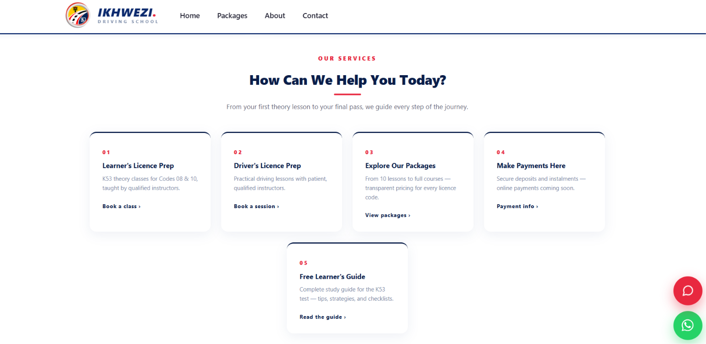

# IKHWEZI Driving School Management System — Website

This repository contains the web application built with C#, ASP.NET Web Forms, and SQL Server. Students use the site to book lessons, view their progress, and submit documents. Staff use role-specific pages to manage student records, payments, and daily operations.

## Features

- Student registration and sign-in
- Lesson booking, learner resources, and student progress tracking
- Student document submission and staff review
- Staff dashboards for receptionists, instructors, and managers
- Payment recording and integration code for PayFast and Paystack

## Technology

| Area | Tools |
| --- | --- |
| Web application | C#, ASP.NET Web Forms, .NET Framework 4.7.2 |
| Frontend | ASPX, HTML, CSS, JavaScript, Bootstrap |
| Data | Microsoft SQL Server |
| Development | Visual Studio, IIS Express, NuGet |

## Local setup

1. On Windows, install Visual Studio with the **ASP.NET and web development** workload and the **.NET Framework 4.7.2 targeting pack**. Install SQL Server or SQL Server LocalDB.
2. Open `WebApplicationM3.sln` and restore NuGet packages.
3. Copy `connectionStrings.example.config` to `connectionStrings.local.config`. Set `KhweziConnection` to your local SQL Server database.
4. Copy `appSettings.example.config` to `appSettings.local.config`. Configure integrations only if you have your own test credentials.
5. Set up the required tables in your local SQL Server database and create test accounts for the roles you want to try. Start the project with IIS Express.

The repository includes source code and sample configuration files. You will need the project’s SQL Server schema and sample accounts separately to test database-backed features. Email, chat, payment, and reporting depend on local configuration.

## Original Azure deployment

The project was originally deployed to [Azure App Service](https://ist-wst-group-27.azurewebsites.net/). Availability may vary.
## Website Screenshots

### Homepage

### Additional Homepage View

